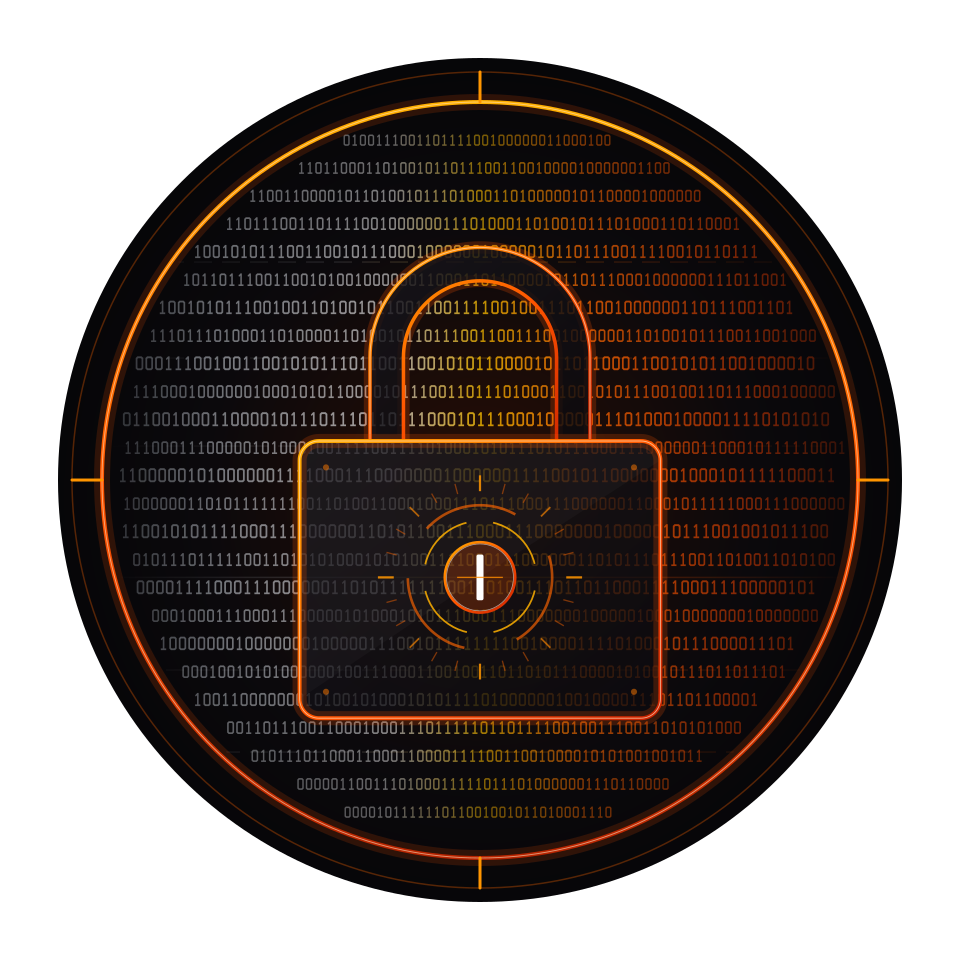

<!--
SPDX-FileCopyrightText: 2026 TSUKUMO Akito <tsukumoakito99@duck.com>
SPDX-License-Identifier: MIT
-->

  

  <h1>ZK-Sovereignty Japan</h1>
  
<strong>自己情報主権・個人情報不可侵推進機構</strong>

  
<em>Zero-Data-Retention Digital Identity &amp; Privacy-Preserving Cryptographic Infrastructure</em>

  

    
    
    
    
  

---

## 🔗 Primary Development Hub

This GitHub organization serves as an official mirror and ecosystem interface. For complete architectural documentation, primary development repositories, and active R&D milestones, please visit our primary hub:

**[Codeberg: @zk-sovereignty-japan](https://codeberg.org/zk-sovereignty-japan)**

---

## 🌐 Mission & Technical Focus

**ZK-Sovereignty Japan** is an independent research and systems engineering initiative building **Privacy-by-Design (PbD)** protocols and low-overhead system software that allow identity and eligibility verification **without collecting, transmitting, or retaining raw personal data**.

- **Digital Identity & Verifiable Credentials:** Zero-knowledge proofs anchored to public IDs (**JPKI / My Number Card**, ePassports), **OpenID4VCI / OpenID4VP**, **SD-JWT**, **BBS+**, **ISO/IEC 18013-5 (mdocs)**, and interoperability alignment with **EUDI Wallet** and Japan's **Digital Agency GIF**.
- **Applied Cryptography & Post-Quantum Readiness:** ZKP circuits & zkVMs (Noir, Circom, Halo2, Arkworks), MPC / threshold signatures (FROST, CGGMP21, TLSNotary), FHE & PIR (TFHE, SimplePIR), and post-quantum cryptography (ML-KEM, ML-DSA).
- **Hardware RoT, TEE & Network Privacy:** Silicon RoT (OpenTitan), **TPM 2.0**, **AMD SEV-SNP / Intel TDX** remote attestation, **Attested OHTTP (RFC 9458)**, and verifiable transparency logs.
- **Systems Engineering:** Deterministic, minimal-dependency implementations in **Zig**, **C**, and **Linux** with **REUSE 3.3** compliance and cryptographically signed releases.

---

## 🇯🇵 日本語 / Japanese

こちらは **Codeberg** を一次開発拠点とする公式ミラー組織です。最新の設計文書・研究開発成果・リポジトリ群は主拠点にて公開しています：
**[Codeberg: @zk-sovereignty-japan](https://codeberg.org/zk-sovereignty-japan)**

**自己情報主権・個人情報不可侵推進機構（ZK-Sovereignty Japan）** は、**プライバシー・バイ・デザイン（PbD）** と **データ最小化原則** に基づき、身分証や個人識別子等の生データを一切預託・保持することなく適合性のみを検証する **個人情報非保持型デジタルアイデンティティ基盤** を研究開発する独立技術開発機構です。

- **デジタルアイデンティティ / VC：** 公的個人認証（JPKI / マイナンバーカード）や電子旅券を活用した匿名資格証明、**OpenID4VCI / VP**、**SD-JWT**、**BBS+**、**ISO/IEC 18013-5**、ならびに **EUDI Wallet**・デジタル庁 **GIF** との相互運用性研究
- **応用暗号・耐量子計算機暗号：** ゼロ知識証明（Noir, Circom, Halo2, zkVM）、MPC / 閾値署名、完全準同型暗号（TFHE）・秘匿情報検索（PIR）、ポスト量子暗号（ML-KEM, ML-DSA）
- **ハードウェア RoT・機密計算・通信プライバシー：** TPM 2.0、AMD SEV-SNP / Intel TDX によるリモートアテステーション、**Attested OHTTP（RFC 9458）**、検証可能透明性ログ
- **システム実装と規律：** **Zig / C / Linux** による高効率・低依存実装、**REUSE 3.3** 準拠および暗号学的署名による透明性の高い開発ガバナンス
